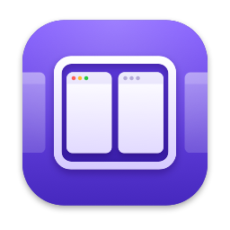
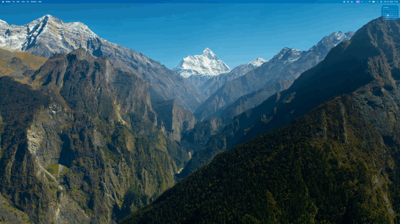

<p align="center">
  
</p>

<h1 align="center">tinywm</h1>

<p align="center"><b>Your windows, on an endless strip.</b><br>
A scrolling window manager for macOS. No more resizing, overlapping or hunting for windows.</p>

---

Every new window opens **next to the one you're using**, on the display you're using, and
nothing else changes size.
The strip simply runs past the edge of your screen. Scroll it with one key or a swipe, and
**every window is exactly where you left it**.

<p align="center"></p>

## Why you'll like it

- **Nothing jumps around.** Opening a window never squeezes the others. Your layout stays put.
- **Silky motion.** Windows glide into place with a spring, smooth even on 120 Hz screens.
- **One key does it all.** Hold **right ⌘** and use H J K L or the arrows. Your normal ⌘ shortcuts keep working.
- **Workspaces that stack.** Keep projects apart, one strip each. Flick up or down to switch.
- **See everything at once.** Press **right ⌘ + Esc** for an overview of every window, then pick one.
- **Swipe with your fingers.** Drag the strip with three fingers on the trackpad.
- **Every display gets its own strip.** Move windows between monitors with one key.
- **Your rules.** Keep calculators floating, ignore apps entirely, stop chatty apps from stealing focus, or open an app on a chosen display and workspace.
- **Plain-text config.** One small file, reloaded the moment you save it.

## Get started

1. Requires macOS 14 Sonoma or later.
2. Build and install (needs Xcode or the Command Line Tools):
   ```sh
   git clone https://github.com/bbodi/tinywm.git
   cd tinywm
   scripts/bundle-tinywm.sh --install
   ```
3. Open **tinywm** from `~/Applications`. A welcome window walks you through the permissions:
   allow **Accessibility** to move windows. **Screen Recording** is optional: it is only for
   live window pictures. It also checks the macOS settings that get in the way: trackpad
   gestures, Stage Manager, tiling at screen edges, click wallpaper to reveal desktop, other
   window managers and Open at Login.
   Reopen it any time from the menu-bar icon (**Welcome…**).

**Downloaded a release instead?** tinywm isn't notarized by Apple yet, so macOS blocks the
first launch. Open it once, then go to **System Settings → Privacy & Security** and click
**Open Anyway**. You only do this once; your permissions stay through updates.

## The keys

Hold **right ⌘** (the "meta" key) and press:

| Key | Does |
|---|---|
| H J K L or ← ↓ ↑ → | Move between windows |
| ⇧ + the same | Move the window itself |
| U / I | Workspace below / above (⇧ takes the window along) |
| . / , | Next / previous display (⇧ takes the window along) |
| W A S D | The display above, left, below or right (⇧ takes the window along) |
| R | Cycle width: ⅓, ½, ⅔ |
| F / C | Full width / centre the window |
| = / − | Wider / narrower |
| [ / ] | Stack the window into its neighbour · ⇧] pops it out |
| T | Float or tile the window |
| V | Focus the floating windows, then the strip again |
| 1 – 9 | Jump to a column |
| Esc | Overview |
| Q | Close the window |

**Drag with the mouse.** Hold the meta key and drag any window, anywhere inside it. The other
windows make room, and a slot shows exactly where it will land: between two columns, above or
below a window in a stack, or on another display. Let go to drop it there, or press Esc to
cancel. A floating window simply moves.

Prefer ⌃⌥ over right ⌘, or different keys? Change anything in the config.

## Make it yours

Choose **Edit Config…** from the menu bar icon. A few lines go a long way:

```
default-width = 0.5            # new windows take half the screen
bind focus-left = n            # remap any key

float    = com.apple.calculator, System Settings
ignore   = com.apple.finder
no-focus = Slack                # never steals focus

send d = cmd+space              # meta+D opens your launcher
run shift+return = open -na Ghostty
focus-crosses-displays = on     # past the last column, focus moves to the next display
```

## Good to know

- tinywm only asks for what it needs: Accessibility to move windows, and Screen Recording
  for live window pictures. Nothing leaves your Mac.
- By default, moving windows show as live pictures, which need Screen Recording. To record
  nothing, turn off **Show Live Window Pictures (Screen Recording)** in the menu-bar icon.
  Moving windows then show as cards with the app's icon and the window's title.
- **Open at Login** is in the menu-bar icon and the welcome window. It works from the installed
  app, not from `swift run`.
- Quitting tinywm puts every window back where it was.
- tinywm remembers your layout and restores it after a restart, as long as the apps keep their
  windows open. After a reboot it matches reopened windows by app and title, as far as it can.
  Turn this off with `restore-layout = off` in the config.
- macOS can't hide single windows, so windows on other workspaces wait just off screen.
- Floating windows (meta+T, `float` rules, fixed-size windows) keep their own frame and show
  in the overview. Meta+V focuses them one after another and then returns to the strip.

## Known limitations

- **Full-screen apps** (the green button) live in their own macOS Space, outside tinywm's strip.
- **Some windows refuse to resize**, like fixed-size dialogs and a few apps. tinywm floats them.
  An app that refuses a narrow width, such as Slack, gets wider columns: tinywm learns the
  narrowest width each app takes and remembers it. Drag the window narrower to lower it again.
- **Password fields pause the meta key.** macOS blocks keyboard shortcuts from other apps while
  you type a password. Use ⌃⌥ instead if you need tinywm there.
- **Trackpad swipes clash with macOS gestures** that use the same number of fingers. The welcome
  window and the menu bar icon warn you and link to Trackpad settings.
- **Floating windows are not kept on top.** macOS keeps the active app's windows above every
  other app's, and raising another app's window can make that app take the keyboard. Meta+V
  brings a floating window up by focusing it, and the overview shows all of them.
- **macOS Spaces** aren't tracked separately. Use tinywm's own workspaces instead, and keep to
  one macOS Space per display.
- **Built for Apple silicon** and tested on macOS 14 and later. Intel Macs are untested.

## For developers

See [docs/DEVELOPING.md](docs/DEVELOPING.md) for the architecture, tests and how to build the app.

## License

Copyright (C) 2026 BB.

tinywm is free software under the [GNU General Public License v3.0](LICENSE). You may use,
change and share it. If you share a changed version, you must share its source under the same
license. For a license without these terms, contact bodidev@gmail.com.
